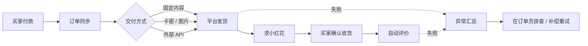
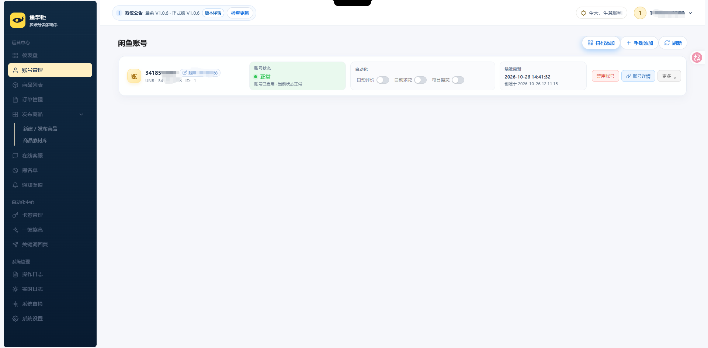
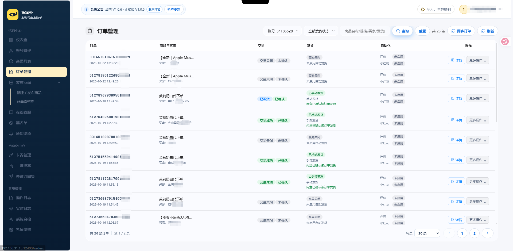
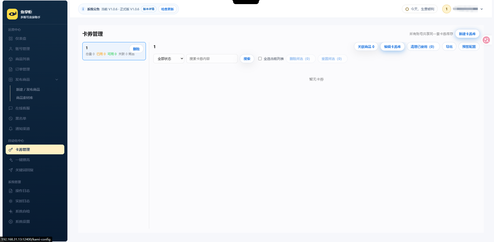
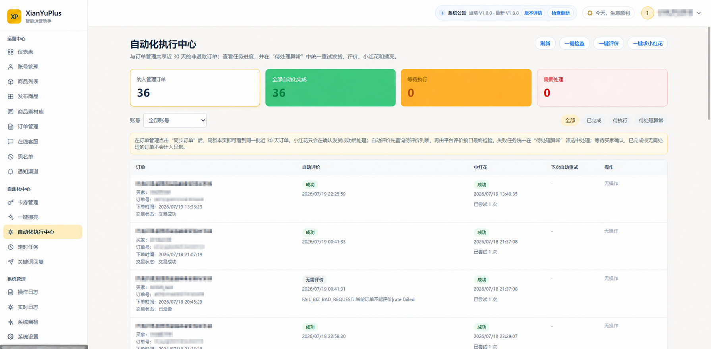
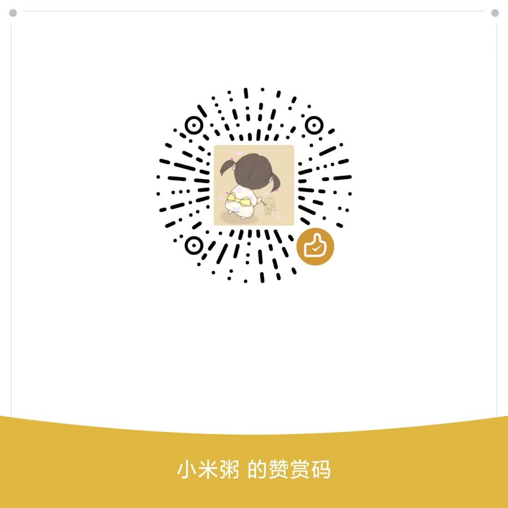

<div align="center">

# 鱼掌柜

**闲鱼多账号运营工作台 · 私有部署**

商品、订单、卡券、发货、客服与自动化，收进一个后台


[快速开始](#快速开始) · [功能地图](#功能地图) · [订单怎么走](#一笔订单怎么走) · [运行机制](#运行机制) · [交流与反馈](#交流与反馈)

</div>

> 本项目与闲鱼平台无官方关联。请在使用前了解并遵守平台规则及所在地法律法规。

---

## 这是什么

鱼掌柜是一套可私有部署的闲鱼多账号运营后台。它不做一个"替你操作平台"的黑盒，而是把每笔订单的处理过程摊开给你看：这件商品走哪种方式发货、卡密取到了没有、平台确认了没有、评价触发没有、失败之后还能不能补。

业务数据留你自己的服务器和数据库里，随时可备份、可导出、可人工接管。

**它适合这样的场景**

- 账号和商品多到靠人工核对订单已经跟不上
- 卖虚拟商品、卡密或网盘资料，需要自动交付，又怕重复发卡
- 想把客服、发货、评价串成一条线，而不是散在几个工具和聊天窗口里

## 功能地图

| 模块 | 能力 |
| --- | --- |
| 📊 运营总览 | 今日成交额、近 30 天交付趋势、商家待办（待处理订单、待人工复核、卡密库存不足）与账号风险，一屏处理。 |
| 👤 闲鱼账号 | 多账号统一管理；Cookie、WebSocket Token、H5 Token 状态集中查看；支持扫码登录与连接自动修复。 |
| 📦 商品列表 | 同步在售商品，按商品单独开启或关闭自动发货、自动回复、AI 与关键词规则；支持一键擦亮。 |
| ➕ 发布商品 | 在后台直接发布商品，不必回到手机端操作。 |
| 🗂️ 商品素材库 | 图片与文案素材集中存放，发货与发布时直接复用。 |
| 📋 订单管理 | 订单、交易、发货、评价、小红花分阶段呈现，避免把"条件没满足"误判成故障；失败的自动化任务可在订单页的异常入口查原因并原地重试。 |
| 💬 在线客服 | 集中会话列表、手动回复、买家标签、黑名单与人工接管；可选接入 AI 自动应答。 |
| 🔑 卡券管理 | 固定内容、本地卡密、图片、外部 API 四种交付；库存预警、待核对、批量重置。 |
| 💭 关键词回复 | 命中关键词即回复，可按商品配置，与 AI 回复互不冲突。 |
| ✨ 一键擦亮 | 批量或定时擦亮在售商品，带擦亮时间配置。 |
| 🔔 通知渠道 | 钉钉、飞书、Bark、PushPlus、通用 Webhook、邮件，六类渠道覆盖新订单、发货异常、凭证失效与库存预警。 |
| 📜 操作记录 · 📟 实时日志 · 🩺 系统自检 | 谁在什么时候做了什么、系统此刻在跑什么、环境哪里不通，都可以自助排查。 |
| ⚙️ 系统设置 | 数据备份与恢复、AI 参数、运行时配置。 |

## 一笔订单怎么走



## 快速开始

**前置**：Docker Engine（或 Docker Desktop）与 Docker Compose v2。

### 一键安装

```bash
curl -fsSL https://raw.githubusercontent.com/najiuwanan511/YuZhanggui/main/install-online.sh | bash
```

脚本会下载到 `~/yuzhanggui`，生成 `.env` 与运行密钥，构建镜像并启动 MySQL 与应用。目录已存在时不会覆盖现有文件，而是列出「就地更新 / 清空数据重装 / 换目录安装」三条命令；想一步重装可加 `--fresh`：

```bash
curl -fsSL https://raw.githubusercontent.com/najiuwanan511/YuZhanggui/main/install-online.sh | bash -s -- --fresh
```

### 手动安装

```bash
git clone https://github.com/najiuwanan511/YuZhanggui.git
cd YuZhanggui
chmod +x install.sh
./install.sh
```

重装或换目录安装时，如果机器上还留着旧的数据库数据卷，脚本会先问你要不要保留数据；不想交互就直接用 `./install.sh --fresh` 清空数据卷全新安装。

**访问** `http://你的设备IP:12400`，首次进入按引导创建管理员账号。

支持 `systemd` 的宿主机（如飞牛 OS）会自动启用网页在线更新代理，之后可在页面顶部"版本详情"里点"立即在线更新"。

### 更新已有部署

```bash
cd ~/yuzhanggui
./update.sh
```

保留数据卷，重新构建并重启。更新前建议先备份。

## 首次配置顺序

1. **账号管理** 添加账号，确认 Cookie 与实时连接正常（也可用扫码登录）。
2. **商品列表** 同步商品，为需要处理的商品打开对应自动化开关。
3. **卡券管理** 建卡券库或固定内容，并关联商品。
4. 用测试商品走一笔小额订单，核对订单状态、发货内容与平台确认结果。
5. **通知渠道** 配置好，确保新订单、发货异常和凭证失效都能收到提醒。
6. 流程确认无误后，再开启自动评价、求小红花等后续动作。

## 订单状态怎么读

| 状态 | 含义 | 你需要做什么 |
| --- | --- | --- |
| 待发货 | 买家已付款，尚未完成交付。 | 检查商品配置、卡券库存，或手动发货。 |
| 已发货 / 已确认 | 内容已处理，平台已确认发货。 | 等买家确认收货。 |
| 待买家确认收货 | 交易仍在已发货阶段，评价尚未触发。 | 无需处理。 |
| 已评价 | 确认收货后评价完成。 | 无需处理。 |
| 评价失败 | 条件已满足，但平台接口确实返回失败。 | 在订单"更多操作"里补评价，或看日志。 |
| 待人工核对 | 平台没有给出明确结果，系统不会重复发送。 | 核对聊天与订单后，再补发或确认。 |

## 交付方式

一个卡券库可以关联多个商品，交付内容有四种：

| 方式 | 适合 | 说明 |
| --- | --- | --- |
| 固定内容 | 网盘链接、教程、统一售后话术 | 不消耗库存。 |
| 本地卡密 | 一行一条的卡密 | 发货后记录订单关联，不会重复取卡。 |
| 图片内容 | 二维码、操作指引、图片资料 | 与固定内容一样可复用。 |
| 外部 API | 上游供应商发卡 | 补发时优先复用已领取内容，减少重复请求。 |

卡券状态包括未使用、已使用、待核对、发货中。批量删除与批量重置会跳过"发货中"的卡券，不影响正在处理的订单。

## 运行机制

<details>
<summary><b>凭证与保活策略</b></summary>

- **Cookie** 用于账号身份与业务接口调用，**WebSocket Token** 用于实时消息与订单事件，**H5 Token** 用于部分网页接口。
- 按需刷新：不再定时调用 `hasLogin`，不强制刷新在线连接；Token 按平台返回的真实过期时间提前刷新。
- 断线先退避重连 5 次，之后每 5 分钟持续重试；待验证或续期中暂停重试。
- 离线订单每 10 分钟补偿同步一次，在线账号由实时事件驱动。
- 离线账号默认 2～4 小时错峰恢复，账号间隔 15 分钟；在线账号不会被巡检强制断开。心跳线程池默认 16，可用 `WEBSOCKET_SCHEDULER_POOL_SIZE` 调整。
- 部署后尽量保持固定公网出口 IP，避免同一账号在短时间内跨地区切换。

</details>

<details>
<summary><b>账号验证与远程浏览器</b></summary>

平台返回 `FAIL_SYS_USER_VALIDATE` 时，该账号会立刻置为待验证，停止业务 API、Token 刷新与 WebSocket 重连。

每个账号使用独立且持久化的浏览器存储、固定 User-Agent、时区与窗口尺寸；完成滑块后只回写该账号的新 `x5sec` Cookie，不与其他账号共享登录状态。

- 桌面部署可设 `CAPTCHA_BROWSER_HEADLESS=false` 直接弹窗处理
- 容器部署默认无头，可用手动更新 Cookie 兜底
- 独立 JAR 未安装 Playwright Chromium 时会尝试系统 Chrome / Edge
- `CAPTCHA_BROWSER_MAX_CONCURRENT` 控制同时处理的验证数量，默认 1

只用 Docker 的飞牛 OS，可开启容器内远程浏览器：

```env
CAPTCHA_BROWSER_REMOTE_ENABLED=true
CAPTCHA_BROWSER_HEADLESS=true
CAPTCHA_BROWSER_VNC_PASSWORD=请替换为自定义密码
```

```bash
docker compose up -d --build
```

然后在同局域网浏览器打开 `http://飞牛IP:7900/vnc.html?autoconnect=true&resize=scale` 完成滑块。VNC 密码最多取前 8 个字符；7900 端口建议只绑定内网地址或走反向代理。

</details>

<details>
<summary><b>在线更新与版本检查</b></summary>

更新代理运行在宿主机的 `systemd` 里，不额外增加容器——Docker 仍然只有应用与 MySQL 两个主要容器。

流程：下载 Release JAR → 校验 SHA256 → 备份数据库与旧版本 → 等自动化任务安全结束后重启。GitHub 直链不可用时会自动切换备用线路，但最终仍以 GitHub API 给出的 SHA256 为准，校验不一致不安装；健康检查失败会自动回滚旧 JAR。

- `UPDATE_DOWNLOAD_PROXY_PREFIXES`：调整或留空禁用备用下载线路
- `UPDATE_GITHUB_TOKEN`：多个容器共用公网 IP 导致 API 限流时填一个只读 Token
- 已有部署若提示"在线更新代理未启用"，执行 `sudo ./deploy/self-update/install-online-update.sh`

</details>

<details>
<summary><b>环境变量升级说明</b></summary>

已有部署的 `.env` 不会随模板自动更新。`./update.sh` 会迁移保活相关设置并留权限受限的备份。若通过网页只更新了 JAR，拉取新代码后还需执行：

```bash
python3 deploy/migrate-websocket-env.py .env
docker compose up -d --no-build --no-deps --force-recreate app
```

重建容器后环境变量才生效。该脚本不会启用 VNC，也不会修改密码。

</details>

## 常用运维

```bash
docker compose ps                          # 服务状态
docker compose logs -f --tail=200 app      # 应用日志
docker compose logs -f --tail=200 mysql    # 数据库日志
docker compose up -d --build               # 重新构建并启动
docker compose down                        # 停止（不删数据卷）
```

业务数据在 Docker 数据卷里。除非已确认完成备份，不要执行 `docker compose down -v`。

`.env`、Cookie、Token、卡密与供应商密钥请妥善保管，不要提交到仓库或发给他人。**尤其要备份 `.env`**：数据库密码在里面，丢失后即使数据卷还在也无法连接。

### 启动报 Access denied（MySQL 1045）

应用反复重启、日志中出现 `Access denied for user 'yuzhanggui'@'...'`，说明 `.env` 里的数据库密码与数据卷中保存的账号密码不一致——重装时生成了新密码，却保留了旧数据卷（MySQL 只在数据卷为空时初始化账号）。

不需要旧数据（重装 / 升级场景）：

```bash
docker compose down -v && docker compose up -d --build
```

需要保留旧数据：把原来的 `.env` 复制回项目目录，或执行 `./install.sh --keep-data` 并按提示输入原密码。

已经装过、只想清库重装：

```bash
cd ~/yuzhanggui && git pull --ff-only origin main && ./install.sh --fresh
```

## 页面预览

| 账号与连接状态 | 订单管理 |
| --- | --- |
|  |  |

| 卡券与库存 | 自动化中心 |
| --- | --- |
|  |  |

## 技术栈

- **后端** Java 21 · Spring Boot · MyBatis-Plus · Flyway · MySQL
- **前端** Vue 3 · TypeScript · Vite
- **部署** Docker Compose · WebSocket 实时连接

## 使用与许可

- 使用前请了解闲鱼平台规则，并自行承担账号与业务运营风险。
- 更新、迁移或重装前，请先备份重要数据。
- 本项目采用 [PolyForm Noncommercial License 1.0.0](LICENSE)，仅限非商业用途。
- 完整限制与免责声明请阅读 [DISCLAIMER.md](DISCLAIMER.md)。

## 交流与反馈

部署完成后，欢迎交流使用体验、功能建议、问题反馈和可改进之处。

<table>
  <tr>
    <td width="33%" align="center"><strong>闲鱼交流微信群</strong></td>
    <td width="33%" align="center"><strong>作者微信</strong></td>
    <td width="34%" align="center"><strong>赞赏支持</strong></td>
  </tr>
  <tr>
    <td width="33%" align="center">
      
    </td>
    <td width="33%" align="center">
      
    </td>
    <td width="34%" align="center">
      
    </td>
  </tr>
</table>

> 群二维码存在有效期；如失效，请通过 GitHub Issue 留言，我会补充新的二维码。添加作者微信时请备注「YuZhanggui」和来意，方便通过。

## 致谢

感谢所有提供反馈、测试结果与改进建议的用户。
